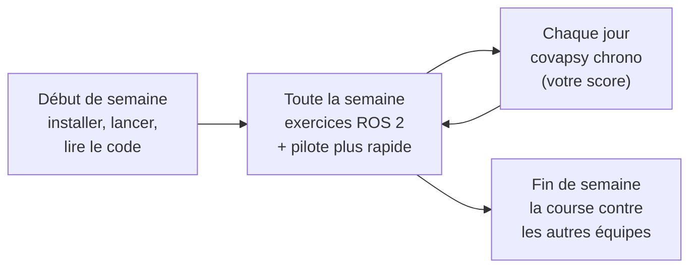
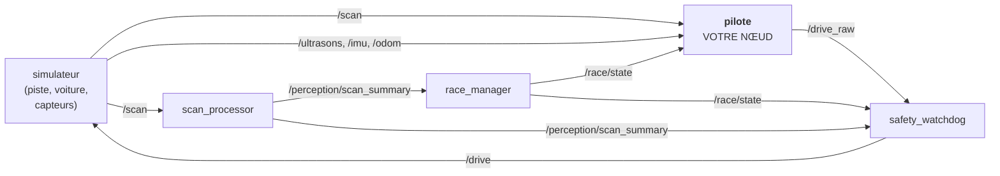
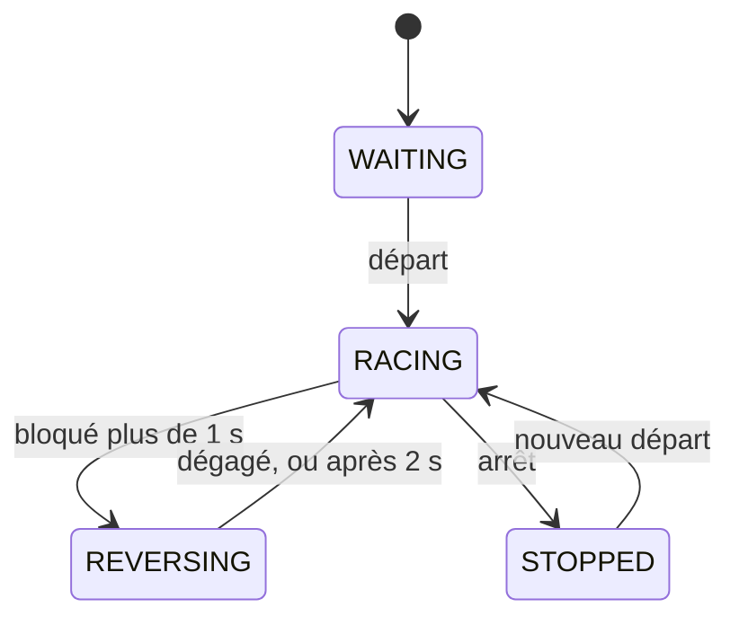
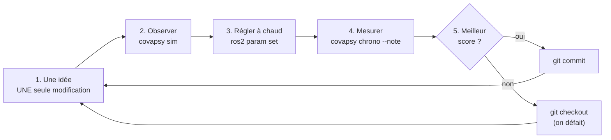
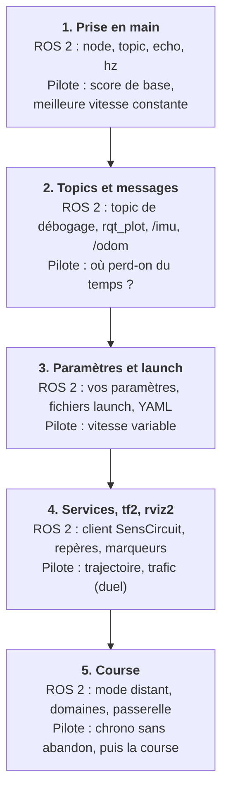
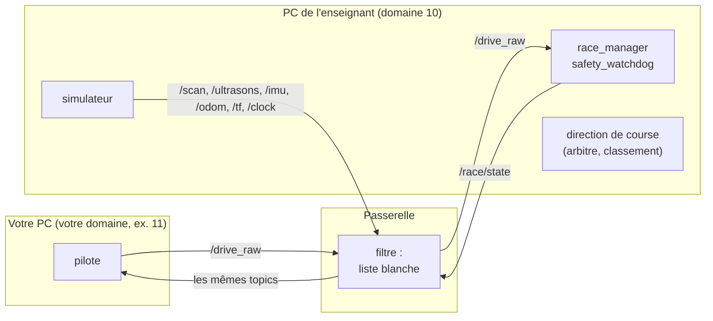

# CoVAPSy : votre voiture autonome en ROS 2

Cette semaine, votre équipe programme **le cerveau d'une petite voiture autonome** (échelle 1/10). Ce cerveau est un programme ROS 2, le nœud **`pilote`**. Il regarde la piste avec ses capteurs et décide, dix fois par seconde, à quelle vitesse rouler et de combien tourner les roues.

Vous avez deux objectifs :

1. **apprendre ROS 2** sur un vrai système : nœuds, topics, messages, paramètres, launch, services, tf2 et les outils `ros2` ;
2. **rendre votre pilote le plus rapide possible**, puis le faire courir contre les autres équipes en fin de semaine.

Bonne nouvelle : le pilote fourni **fonctionne déjà**. Il fait le tour de la piste, mais à vitesse constante (1 m/s), comme un débutant prudent. À vous de lui apprendre à aller vite. Nous ne vous donnons pas la solution : c'est tout l'intérêt du défi.

---

**Sommaire**

1. [Le projet en un coup d'œil](#1-le-projet-en-un-coup-dœil)
2. [Installer le projet (une seule fois)](#2-installer-le-projet-une-seule-fois)
3. [Premier lancement (10 minutes)](#3-premier-lancement-10-minutes)
4. [Comprendre ce qui tourne](#4-comprendre-ce-qui-tourne)
5. [Votre code](#5-votre-code)
6. [Travailler au quotidien](#6-travailler-au-quotidien)
7. [Exercices ROS 2](#7-exercices-ros-2)
8. [Le défi vitesse](#8-le-défi-vitesse)
9. [Le jour de la course](#9-le-jour-de-la-course)
10. [Ça ne marche pas ?](#10-ça-ne-marche-pas-)
11. [Petit glossaire](#11-petit-glossaire)

---

## 1. Le projet en un coup d'œil



- **Pendant la semaine**, tout tourne sur votre PC : un simulateur affiche la piste et la voiture, et votre nœud la conduit.
- **Le jour de la course**, le simulateur tourne sur le PC de l'enseignant. Votre nœud, lui, reste sur votre PC et conduit votre voiture à distance. C'est **le même code**, sans rien changer.

## 2. Installer le projet (une seule fois)

Comptez environ 30 minutes. Il vous faut :

- un PC sous Linux (Ubuntu conseillé) avec **Docker** ou **Podman** ;
- **VS Code** avec l'extension **Dev Containers** ;
- avec Podman uniquement : dans les réglages de VS Code, mettez `dev.containers.dockerPath` à `podman`.

```bash
git clone https://github.com/F-KHENFRI/covapsy-ros2-pilote.git
cd covapsy-ros2-pilote
xhost +local:        # autorise les fenêtres du conteneur (à refaire après chaque redémarrage du PC)
code .
```

Dans VS Code, ouvrez la palette de commandes (`Ctrl+Maj+P`) et choisissez **Dev Containers: Reopen in Container**.

- La première fois, VS Code prépare l'environnement et compile le projet : quelques minutes de patience.
- Ouvrez ensuite un terminal (menu *Terminal* → *Nouveau terminal*). Il doit afficher `CoVAPSy équipe : ROS_DOMAIN_ID=11`.
- **Toutes les commandes de ce guide se tapent dans ce terminal**, c'est-à-dire dans le conteneur.

Sans VS Code, `./conteneur.sh` ouvre le même environnement dans votre terminal habituel. `./conteneur.sh covapsy chrono` lance une seule commande.

Votre école passe par un proxy ? Avant la première construction, copiez ses certificats `.crt` dans `.devcontainer/certificats/`.

**Quand vous connaissez votre numéro d'équipe**, remplissez `student_ws/equipe.yaml` : `numero`, `nom` et `domaine` (10 + numéro, donné par l'enseignant). Ouvrez ensuite un **nouveau terminal** pour que le changement soit pris en compte.

## 3. Premier lancement (10 minutes)

Suivez ces étapes dans l'ordre. À chaque fois, vérifiez que vous voyez bien le résultat attendu.

| Étape | Commande | Ce que vous devez voir |
| --- | --- | --- |
| 1 | `covapsy aide` | la liste des commandes |
| 2 | `covapsy sim ovale` | une fenêtre : au bout de 2 s, la voiture démarre et fait le tour à 1 m/s |
| 3 | dans un **2e terminal** : `ros2 node list` | `/pilote /race_manager /safety_watchdog /scan_processor /simulateur` |
| 4 | `ros2 topic echo /drive_raw --once` | la dernière commande de votre nœud : `speed` ≈ 1.0 et `steering_angle` |
| 5 | `ros2 param set /pilote vitesse 1.5` | la voiture accélère tout de suite, sans rien redémarrer |
| 6 | fermez la fenêtre, puis `covapsy chrono --note "pilote de base"` | après environ 1 min 15 : `SCORE : 224 s` environ |

Notez ce score : c'est **votre point de départ**. Chaque amélioration se mesure par rapport à lui.

Astuce : chaque commande `covapsy` affiche la vraie commande ROS 2 qu'elle lance (la ligne qui commence par `$`). Lisez-la : c'est la meilleure façon d'apprendre les commandes `ros2`.

### Ce que vous voyez dans la fenêtre

| Élément | Signification |
| --- | --- |
| rectangle de couleur | votre voiture (jaune = `car1`) ; en duel, les adversaires ont d'autres couleurs |
| **flèche** partant de la voiture | la **direction visée par votre nœud** (topic `/pilote/angle_cible`) |
| points rouges | ce que voit le lidar de la première voiture : ce que « voit » votre nœud |
| bordures **vertes** et **rouges** | les couleurs de la piste ; par défaut, vert à droite et rouge à gauche dans le sens de course |
| blocs gris | obstacles |
| trait fin | la trajectoire récente |
| pointillés | la ligne d'arrivée |
| texte sous la piste | temps, tours, dernier et meilleur tour, vitesse, nombre de chocs |

## 4. Comprendre ce qui tourne

### Les nœuds et les topics

Quand vous lancez `covapsy sim`, cinq nœuds ROS 2 travaillent ensemble. Ils se parlent par des **topics** : des canaux nommés où un nœud publie des messages et où d'autres les reçoivent.



| Nœud | Son rôle |
| --- | --- |
| `simulateur` | la piste, la voiture et ses capteurs ; il donne aussi le temps simulé (`/clock`) et rend le service `/perception/sens_circuit` |
| `scan_processor` | résume le lidar : la distance la plus proche dans chaque secteur (devant, côtés, derrière) |
| `race_manager` | décide de l'**état de course** : attendre, rouler, reculer, s'arrêter |
| `safety_watchdog` | le **garde du corps** : il a le dernier mot sur ce qui part vers les roues |
| **`pilote`** | **vous** : il lit les capteurs et l'état de course, puis publie une commande sur `/drive_raw` |

Retenez une chose : **votre commande ne va pas directement aux roues**. Elle passe par `safety_watchdog`, qui impose une vitesse nulle hors course, freine en urgence devant un obstacle et coupe tout si votre nœud se tait. Vous ne pouvez pas le contourner, et c'est voulu.

### Les états de course

`race_manager` publie l'état sur `/race/state`. Votre nœud doit en tenir compte :



Le départ est automatique après 2 s en local, et donné par l'enseignant en course. En `WAITING` et `STOPPED`, la voiture reste immobile quoi que vous publiiez. En `REVERSING`, c'est à votre nœud de reculer (fonction `se_degager`).

### Ce que votre nœud peut utiliser

| Entrée | Contenu | À quoi ça sert |
| --- | --- | --- |
| `/scan` | lidar à 360°, un point par degré, environ 10 Hz, portée 12 m | voir les murs, les virages, les autres voitures |
| `/ultrasons` | les 4 ultrasons dans un seul message : `avant`, `arriere`, `gauche`, `droite` (m, `inf` = rien à moins de 2 m), 20 Hz | distances très proches, sécurité |
| `/imu` | centrale inertielle, 50 Hz : vitesse de rotation (`angular_velocity.z`) et accélérations | savoir si l'on tourne, mesurer l'accélération dans un virage |
| `/odom` | odométrie, 50 Hz : vitesse mesurée aux roues et position **estimée** depuis la grille | connaître votre vraie vitesse ; attention, la position **dérive** avec le temps |
| `/tf`, `/tf_static` | les repères : `car1/odom → car1/base_link → car1/laser` (et `us_*`, `camera`) | placer les mesures dans l'espace, visualiser dans rviz2 |
| `/race/state` | l'état de course | savoir quand rouler, reculer, s'arrêter |
| `/perception/sens_circuit` (**service**) | répond « bon sens », « contresens » ou « indécis » | vérifier le sens de circulation |
| `/clock` | le temps simulé | tous les nœuds suivent cette horloge (`use_sim_time`) |

Il n'y a **ni carte ni position réelle**. C'est le règlement : le circuit de la course n'est pas connu à l'avance, votre voiture doit se débrouiller avec ce qu'elle voit.

Ce que votre nœud publie :

| Sortie | Contenu |
| --- | --- |
| `/drive_raw` | **votre commande** : `drive.speed` (m/s) et `drive.steering_angle` (rad) |
| `/pilote/angle_cible` | pour le débogage : la direction visée (dessinée en flèche dans la fenêtre) |
| `/pilote/marqueur` | pour le débogage : la même direction en flèche 3D pour rviz2 |

**Les conventions à retenir** (norme ROS REP 103) : un angle ou un braquage **positif, c'est à gauche** ; une vitesse positive, c'est en avant. Le braquage est limité à 0,35 rad (environ 20°) et la vitesse à 3 m/s.

### Le service « sens du circuit »

Les bordures de la piste sont colorées : **vert à droite et rouge à gauche** dans le bon sens. L'enseignant peut inverser le sens d'une manche ; il vous le dira. Le simulateur regarde ces couleurs avec sa caméra et peut vous dire si vous roulez dans le bon sens :

```bash
ros2 service call /perception/sens_circuit covapsy_interfaces/srv/SensCircuit "{couleur_droite: vert, couleur_gauche: rouge}"
# réponse : success, sens (1 = bon sens, -1 = CONTRESENS, 0 = indécis), score, message
```

Le service fait la moyenne de ce qu'il voit sur environ une seconde, car une seule image prise dans un virage serré peut tromper. Pour voir un contresens : `covapsy sim ovale couleur_droite:=rouge`, puis posez la même question. En course, la même commande fonctionne : le service est relayé jusqu'à votre PC.

## 5. Votre code

```
student_ws/
├── equipe.yaml                        ← votre équipe (numéro, domaine, mode)
├── covapsy                            ← la commande « covapsy »
└── src/
    ├── covapsy_pilote/                ← VOTRE PAQUET : le seul que vous modifiez
    │   ├── covapsy_pilote/pilote.py   ← LE NŒUD : c'est ici que vous travaillez
    │   ├── covapsy_pilote/outils_scan.py   petites fonctions utiles pour le lidar
    │   ├── covapsy_pilote/pilote_base.py   l'adversaire des duels : NE PAS MODIFIER
    │   ├── config/pilote.yaml         ← vos réglages (paramètres ROS 2)
    │   └── setup.py, package.xml      exécutables et dépendances
    ├── covapsy_student_bringup/       fichiers launch (sim, chrono, duel) : à lire
    ├── covapsy_autonomy/              infrastructure de la course : à lire, pas à modifier
    ├── covapsy_interfaces/            messages et services CoVAPSy
    └── covapsy_simple_sim/            le simulateur
```

### Visite guidée de `pilote.py`

Lisez-le de haut en bas, il est fait pour ça :

1. **`PARAMETRES`** : les réglages, chacun avec sa description (`ros2 param describe /pilote vitesse`).
2. **`__init__`** : déclaration des paramètres, **abonnements** (`create_subscription`) et **publications** (`create_publisher`). C'est la carte d'identité ROS 2 du nœud.
3. **`on_scan`** : appelé à chaque tour du lidar. Il décide, puis publie `/drive_raw`.
4. **`calculer_braquage`, `calculer_vitesse`, `se_degager`** : la façon de conduire. Les repères `AMÉLIORATION` montrent où chercher.
5. **`publier_debogage`** : publie la flèche et l'angle visé. Prenez-le comme modèle pour vos propres topics de débogage.

Le pilote fourni fait trois choses simples :
- il vise la direction la plus dégagée devant lui ;
- il roule à **vitesse constante** ;
- il ralentit seulement si un obstacle est à moins de 1 m droit devant (anti-collision).

### Faut-il recompiler ?

- **Non**, si vous modifiez seulement `pilote.py` ou `pilote.yaml` : relancez simplement `covapsy sim`.
- **Oui**, avec `covapsy compiler` puis un nouveau terminal, si vous ajoutez un fichier, un exécutable dans `setup.py` ou un paquet.

## 6. Travailler au quotidien

### Le cycle de travail

Toute la semaine, vous allez tourner dans cette boucle :



- **Une seule modification à la fois.** Sinon, impossible de savoir ce qui a aidé.
- **Notez toujours ce que vous avez changé** avec `--note`, puis comparez avec `covapsy historique`.
- Un écart de moins de 0,5 s entre deux chronos n'est **pas significatif** : deux mesures du même pilote diffèrent d'environ 0,3 s.
- De temps en temps, **mesurez-vous aux autres** avec `covapsy duel` (voir §8).

### La boîte à outils ROS 2

| Je veux… | Commande |
| --- | --- |
| voir les nœuds et leurs liens | `ros2 node list`, `ros2 node info /pilote`, `rqt_graph` |
| voir les topics et leurs types | `ros2 topic list -t`, `ros2 topic info -v /scan` |
| lire un topic | `ros2 topic echo /race/state`, `ros2 topic echo /odom --field twist.twist.linear.x` |
| mesurer une fréquence | `ros2 topic hz /scan` |
| connaître un message | `ros2 interface show covapsy_interfaces/msg/Ultrasons` |
| lire ou changer un paramètre | `ros2 param list /pilote`, `ros2 param get /pilote vitesse`, `ros2 param set /pilote vitesse 1.5` |
| sauver mes réglages | `ros2 param dump /pilote > reglage.yaml` |
| tracer des courbes | `ros2 run rqt_plot rqt_plot /pilote/angle_cible/data /drive_raw/drive/steering_angle` |
| voir le scan et la direction visée en 3D | `rviz2 --ros-args -p use_sim_time:=true`, puis *Fixed Frame* `car1/laser`, *Add* → *LaserScan* `/scan` et *Marker* `/pilote/marqueur` |
| voir les repères | `ros2 run tf2_tools view_frames`, `ros2 run tf2_ros tf2_echo car1/odom car1/laser` |
| appeler un service | `ros2 service call /perception/sens_circuit covapsy_interfaces/srv/SensCircuit "{couleur_droite: vert, couleur_gauche: rouge}"` |
| enregistrer et rejouer | `ros2 bag record -o essai /scan /drive_raw /race/state /clock`, puis `ros2 bag play essai` |

Pour rviz2, ajoutez toujours `--ros-args -p use_sim_time:=true` : le simulateur a sa propre horloge.

## 7. Exercices ROS 2

Lancez `covapsy sim ovale`, puis faites ces exercices dans un 2e terminal. Ils sont rangés du plus simple au plus avancé.

| Thème | À faire |
| --- | --- |
| Le graphe | `ros2 node list`, `ros2 node info /pilote`, `rqt_graph` : retrouvez le schéma du §4 |
| Les topics | `ros2 topic list -t`, `ros2 topic hz /scan`, `ros2 topic echo /race/state`, `ros2 interface show ackermann_msgs/msg/AckermannDriveStamped` |
| Un message maison | `ros2 interface show covapsy_interfaces/msg/Ultrasons` et `ros2 topic echo /ultrasons`. Comparez avec `sensor_msgs/msg/Range`, le message standard d'**un seul** télémètre : qu'est-ce qu'on gagne, qu'est-ce qu'on perd à regrouper les 4 capteurs ? |
| Les paramètres | `ros2 param list /pilote`, `ros2 param describe /pilote vitesse`, `ros2 param set /pilote vitesse 1.3`, puis `ros2 param dump /pilote` |
| Le fichier de paramètres | reportez votre meilleur réglage dans `config/pilote.yaml`, relancez, et vérifiez avec `ros2 param get` |
| Visualiser | `rviz2 --ros-args -p use_sim_time:=true` : *Fixed Frame* `car1/laser`, *Add* → *LaserScan* `/scan`, *Marker* `/pilote/marqueur` (la flèche verte), *MarkerArray* `/perception/markers` |
| Déboguer | regardez la flèche de votre voiture dans la fenêtre : c'est `pilote/angle_cible`. Tracez-la avec `ros2 run rqt_plot rqt_plot /pilote/angle_cible/data /drive_raw/drive/steering_angle` |
| Enregistrer | `ros2 bag record -o essai /scan /drive_raw /race/state /clock`, puis `ros2 bag info essai` et `ros2 bag play essai` |
| Un nouveau topic | publiez dans `pilote.py` la distance libre devant (`std_msgs/Float32` sur `pilote/distance_avant`), puis tracez-la avec `rqt_plot` |
| Un nouveau paramètre | ajoutez un paramètre à vous (par exemple `freinage_max`), utilisez-le, réglez-le avec `ros2 param set` |
| Les launch | lisez `covapsy_student_bringup/launch/pilote.launch.py` : arguments, nœuds, paramètres, événement de fin. Essayez `covapsy sim epingle facteur_temps_reel:=2.0` |
| Les namespaces | pendant `covapsy duel`, `ros2 node list` montre `/car1/pilote`, `/car2/adversaire`… Pourquoi la même configuration sert-elle à toutes les voitures ? Indice : les clés `/**/` des fichiers YAML |
| Les services | `ros2 service list`, `ros2 service call /race/stop std_srvs/srv/Trigger`, puis `/race/start` ; et le service `/perception/sens_circuit` (§4) |
| La QoS | `ros2 topic info -v /race/state` affiche *transient local* : pourquoi ? Et pourquoi `/scan` est-il reçu en *best effort* ? |
| tf2 et rviz2 | `ros2 run tf2_tools view_frames`, `ros2 run tf2_ros tf2_echo car1/odom car1/laser`. Dans rviz2, *Fixed Frame* `car1/odom`, ajoutez *TF* et *LaserScan* : la voiture se déplace et le scan la suit. En duel : `rviz2 --ros-args -p use_sim_time:=true -r /tf:=/car1/tf -r /tf_static:=/car1/tf_static` |
| IMU et odométrie | `ros2 topic echo /odom --field twist.twist.linear.x` donne votre vraie vitesse : comparez-la à la consigne de `/drive_raw`. Tracez `/imu/angular_velocity/z` dans un virage. Après 3 tours, de combien l'odométrie a-t-elle dérivé ? |
| Un client de service | dans `pilote.py`, appelez `SensCircuit` toutes les 2 s **sans bloquer** votre nœud, et affichez un avertissement en cas de contresens (exemple ci-dessous) |

Exemple de client de service **asynchrone** :

```python
from covapsy_interfaces.srv import SensCircuit
...
# dans __init__ :
self.client_sens = self.create_client(SensCircuit, 'perception/sens_circuit')
self.create_timer(2.0, self.verifier_sens)

def verifier_sens(self):
    if not self.client_sens.service_is_ready():
        return
    requete = SensCircuit.Request(couleur_droite='vert', couleur_gauche='rouge')
    self.client_sens.call_async(requete).add_done_callback(self.on_sens)

def on_sens(self, futur):
    reponse = futur.result()
    if reponse.success and reponse.sens < 0:
        self.get_logger().warning(f'contresens ! {reponse.message}')
```

N'utilisez **jamais** un appel bloquant (`call`) dans un callback : votre nœud ne traiterait plus rien pendant l'attente, et l'appel pourrait même ne jamais se terminer.

## 8. Le défi vitesse

Votre mission : rendre votre pilote **le plus rapide possible, sans percuter**. La méthode, c'est à vous de la trouver ; voici tout ce qu'il faut pour chercher.

### Mesurer : `covapsy chrono`

```bash
covapsy chrono --note "pilote de base"
```

```
circuit                        total meilleur chocs  remarque
piste_officielle_obstacles     98.21    32.20     0
epingle                        77.61    25.30     0
ovale_obstacles                48.11    15.10     1

SCORE : 223.93 s   (somme des temps ; plus petit = meilleur)
```

| Colonne | Signification |
| --- | --- |
| `total` | temps du départ à la fin du 3e tour. Pas fini en 180 s simulées : abandon, compté 180 s |
| `meilleur` | votre meilleur tour |
| `chocs` | contacts avec un mur ou un obstacle ; chacun coûte du temps |
| **SCORE** | la somme sur les 3 circuits : **plus c'est petit, mieux c'est** |

Comment ça marche : pour chaque circuit, `covapsy chrono` lance un vrai système ROS 2 avec le simulateur (4 fois plus vite que le temps réel), l'infrastructure, **votre nœud** et un nœud `chronometre` qui compte 3 tours puis arrête tout.

- Chaque chrono est enregistré dans `student_ws/chronos.csv` ; `covapsy historique` affiche tous vos essais.
- Le chrono tourne dans son propre « réseau » ROS 2 (domaine 99). Vous pouvez donc garder `covapsy sim` ouvert pendant une mesure.
- Pour regarder un seul circuit en direct : `ros2 launch covapsy_student_bringup chrono.launch.py circuit:=epingle affichage:=true facteur_temps_reel:=1.0`.

### Se mesurer aux autres : `covapsy duel`

```bash
covapsy duel                              # piste officielle, adversaires « lent » (1 m/s)
covapsy duel piste_officielle moyen       # adversaires à 1,5 m/s
covapsy duel piste_officielle rapide      # adversaires à 1,8 m/s
```

Quatre voitures partagent la piste, chacune dans son **namespace** : `/car1` pour vous, `/car2` à `/car4` pour les adversaires. Les adversaires sont le pilote de base, réglé à différentes vitesses. Il faut aller vite **et** gérer le trafic. Objectif : gagner au niveau `rapide`.

### Régler sans recompiler

Pendant `covapsy sim piste_officielle_obstacles` :

```bash
ros2 param set /pilote vitesse 1.3
ros2 param dump /pilote > mon_reglage.yaml
```

L'effet est immédiat. Reportez les bonnes valeurs dans `config/pilote.yaml` : c'est ce fichier que `covapsy chrono` utilise. Quand vous écrivez votre propre logique, déclarez ses réglages comme **nouveaux paramètres** : vous pourrez les ajuster de la même façon.

### Ce qu'il faut savoir sur la voiture

| Grandeur | Valeur |
| --- | --- |
| vitesse maximale (bridée par la sécurité) | 3 m/s |
| braquage maximal | 0,35 rad |
| empattement (distance entre les essieux) | 0,257 m |
| accélération | environ 4 m/s² |
| freinage | environ 8 m/s² |
| adhérence dans les virages (accélération latérale maximale) | environ 6 m/s² ; au-delà, la voiture glisse et élargit sa trajectoire |

### Des questions pour chercher

Les repères `AMÉLIORATION` de `pilote.py` vous mettent sur la piste. Pour le reste, posez-vous ces questions :

1. **Vitesse constante** : quelle est la plus grande vitesse constante qui finit les 3 circuits ? Combien coûtent les chocs ? Que fait l'anti-collision dans les épingles ?
2. **Vitesse variable** : où la voiture perd-elle du temps ? Faut-il la même vitesse en ligne droite et en virage ? Avec le tableau ci-dessus, à quelle vitesse peut-on passer un virage donné ? Comment le scan annonce-t-il qu'un virage arrive, et à quelle distance faut-il commencer à freiner ?
3. **Trajectoire** : viser la direction la plus dégagée, est-ce le meilleur chemin ? Que se passe-t-il près du mur intérieur ?
4. **Course à plusieurs** : comment suivre une voiture plus lente sans la percuter ? Comment la doubler ? Une marche arrière coûte environ 2 s.
5. **Pour aller plus loin** : les ultrasons, l'IMU (votre vitesse de rotation, l'accélération latérale), le filtrage du scan, ou un nœud de perception séparé relié à votre pilote par vos propres topics.

Pour vérifier une idée, publiez la valeur qui vous intéresse sur un topic de débogage et tracez-la avec `rqt_plot`.

### Les règles du défi

- Vous ne modifiez que le paquet `covapsy_pilote` (sauf `pilote_base.py`). Vous pouvez y ajouter des fichiers, des nœuds et des paramètres.
- Votre nœud publie `/drive_raw` à chaque `/scan` et reste rapide : `on_scan` affiche son temps de calcul, à garder **sous 50 ms**.
- Aucune information sur la piste écrite en dur : ni carte, ni liste de virages, ni positions.
- Avant la course, `covapsy chrono` doit tourner **sans aucun abandon**.

Un pilote rapide mais fragile perd la course. Visez **rapide et fiable**.

### Un parcours possible pour la semaine

Adaptez-le au rythme de votre enseignant.



## 9. Le jour de la course

Le jour J, votre nœud reste sur votre PC. Le simulateur, l'arbitre et les autres voitures tournent sur le PC de l'enseignant. Une **passerelle** fait le lien et ne laisse passer que ce dont votre pilote a besoin.



La passerelle ne laisse **jamais** passer les vraies positions, la carte ni les autres voitures.

1. Dans `equipe.yaml`, mettez le bon `domaine` (donné par l'enseignant), puis ouvrez un nouveau terminal.
2. Faites un dernier `covapsy chrono` : **aucun abandon** n'est accepté.
3. Lancez `covapsy course` : votre nœud seul, en mode distant.
4. Dans un 2e terminal, lancez `covapsy diag` : `/scan`, `/race/state` et `/clock` doivent être reçus.
5. Lancez `covapsy pret`, ou cliquez sur « Nous sommes prêts » sur `http://<PC-enseignant>:8080/equipe` avec le code donné par l'enseignant.
6. L'enseignant donne le départ. En départ individuel, c'est vous qui démarrez avec `covapsy depart`.

### Plusieurs manches

L'enseignant peut organiser une **série de manches** :
- **rotation des places de départ** : chaque équipe part une fois de chaque place ;
- **manches en sens inverse** : **votre pilote doit donc fonctionner dans les deux sens** ;
- **classement général** : les points de toutes les manches s'additionnent.

Votre page équipe affiche la manche, le sens, la couleur de la bordure de droite et votre place de départ. Vous les retrouvez aussi dans le topic `/course/statut` (JSON : `sens`, `couleur_droite`, `place_depart`, `serie`), pratique pour interroger le service `/perception/sens_circuit` avec les bonnes couleurs.

### Ce que l'arbitre surveille

- plus de **2 m à contresens** : la voiture est retirée de la piste ;
- immobile plus de **10 s** sans voiture qui la bloque : la voiture est retirée ;
- le départ est donné par l'enseignant, pas avant ;
- si votre nœud ne publie plus sur `/drive_raw` pendant 1 s, la voiture s'arrête.

Une voiture retirée ne gêne pas les autres. Elle revient à la manche suivante.

## 10. Ça ne marche pas ?

Pas de panique, voici les problèmes les plus fréquents.

| Ce que vous voyez | Ce qu'il faut faire |
| --- | --- |
| `covapsy : commande introuvable` | ouvrez un nouveau terminal, ou `source student_ws/setup_equipe.bash` |
| pas de fenêtre du simulateur | sur votre PC (hors conteneur) : `xhost +local:`, puis relancez. Sinon : `covapsy sim ovale affichage:=false` |
| `ros2 node list` vide dans le 2e terminal | les deux terminaux n'ont pas le même `ROS_DOMAIN_ID` : ouvrez-en un nouveau. Les outils `ros2` mettent aussi parfois quelques secondes à tout découvrir |
| `does not appear to be published yet` | les outils `ros2` n'ont pas encore découvert le topic : attendez quelques secondes et relancez |
| `The message type '…' is invalid` | ce terminal n'a pas chargé votre workspace : `source student_ws/setup_equipe.bash`. Si l'erreur continue : `covapsy compiler`, puis nouveau terminal |
| la voiture ne bouge pas | `ros2 topic echo /race/state` (le départ automatique a lieu après 2 s), puis `ros2 topic echo /drive_raw` (votre nœud publie-t-il ?) |
| votre nœud s'arrête avec une `Traceback` | lisez la fin du message : le fichier, la ligne et l'erreur dans `pilote.py` |
| un paramètre n'a aucun effet | est-il bien lu dans `on_scan` avec `self.p('nom')` ? |
| un nouveau fichier ou exécutable est introuvable | `covapsy compiler`, puis nouveau terminal |
| rviz2 n'affiche rien | avez-vous mis `use_sim_time:=true` ? Le *Fixed Frame* est-il bien `car1/laser` ou `car1/odom` ? |
| « Reopen in Container » échoue (certificat) | copiez les certificats du proxy dans `.devcontainer/certificats/`, puis *Rebuild Container* |

## 11. Petit glossaire

| Mot | Ce que ça veut dire |
| --- | --- |
| **nœud** | un programme ROS 2 ; votre `pilote` en est un |
| **topic** | un canal nommé : des nœuds y publient des messages, d'autres s'y abonnent (`/scan`) |
| **message** | une donnée avec un type précis, qui circule sur un topic (`sensor_msgs/msg/LaserScan`) |
| **service** | une question et sa réponse entre deux nœuds (`/perception/sens_circuit`) |
| **paramètre** | un réglage d'un nœud, modifiable pendant qu'il tourne (`vitesse`) |
| **launch** | un fichier qui démarre plusieurs nœuds d'un coup, avec leurs réglages (`pilote.launch.py`) |
| **namespace** | un préfixe pour distinguer plusieurs voitures (`/car1/scan`, `/car2/scan`) |
| **domaine** (`ROS_DOMAIN_ID`) | un « réseau » ROS 2 à part : chaque équipe a le sien |
| **QoS** | les règles de livraison d'un topic : fiable ou « au mieux », dernier message gardé ou non |
| **tf2, repère** | la position des repères les uns par rapport aux autres (`car1/odom → car1/base_link → car1/laser`) |
| **temps simulé** (`use_sim_time`) | les nœuds suivent l'horloge du simulateur (`/clock`), pas celle du PC |

Bonne semaine, et bonne course !
